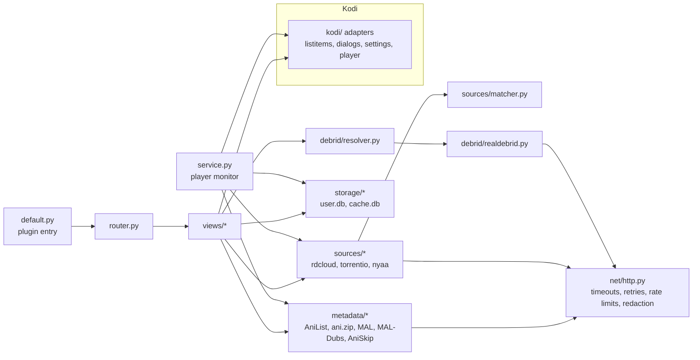
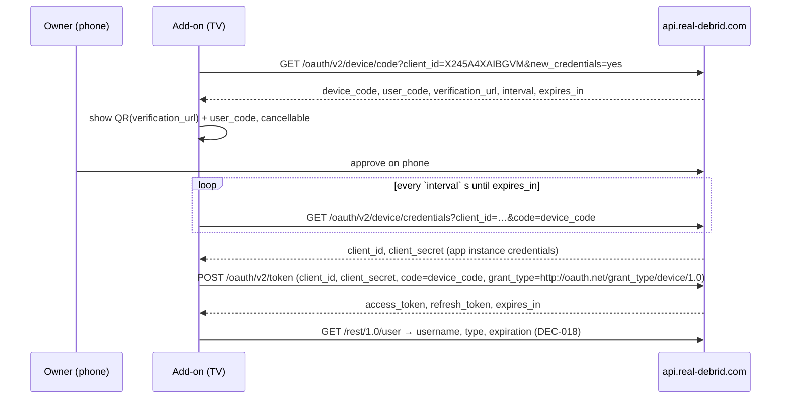

# Architecture Proposal — v1

Status: **Approved (DEC-044, 2026-10-10).** Based on approved decisions DEC-001…DEC-043 (`decisions.md`) and the approved v1 scope (`feature_backlog.md`). Add-on: **AniVerse**, `plugin.video.aniverse` (DEC-045); `<id>` below = `aniverse`.

Evidence for new technical facts in this document was gathered 2026-10-10 by live read-only probes; see §12.

---

## 1. Design principles

1. **Three separate layers**, as required by the research: *metadata* (what anime/episodes exist) → *source discovery* (which releases might contain that episode) → *resolution* (Real-Debrid turns the chosen release into a stream). Each can be changed without touching the others.
2. **Kodi at the edges only.** Business logic never imports `xbmc*`. Kodi calls live in one thin adapter package, so most code runs under plain `pytest` on Windows.
3. **No module without a reason.** Each module below states why it exists.
4. **Stdlib first.** HTTP via `urllib` + `ssl`; storage via `sqlite3`; JSON not pickle. One Kodi dependency (QR code).
5. **The owner decides.** Nothing auto-selects a source (DEC-004). Unknown data is shown as absent, never guessed.

## 2. Components



## 3. Directory structure

```
<project root>/                        # own git repo (not the home-folder repo)
  plugin.video.<id>/
    addon.xml                          # pluginsource + service extensions
    default.py                         # plugin entry: parse sys.argv → router
    service.py                         # player monitor + light housekeeping
    resources/
      settings.xml                     # Kodi settings (v2 format)
      language/resource.language.en_gb/strings.po
      media/                           # icon, fanart
      lib/
        router.py
        models.py                      # dataclasses (§4)
        errors.py                      # exception hierarchy (§8)
        redact.py                      # secret masking for logs/exceptions
        kodi/                          # ONLY place that imports xbmc*, xbmcgui, xbmcplugin, xbmcaddon, xbmcvfs
          ui.py  dialogs.py  settings.py  player.py  log.py  paths.py
        net/http.py
        metadata/anilist.py  anizip.py  mal.py  dubs.py  aniskip.py  catalog.py
        sources/base.py  rdcloud.py  torrentio.py  nyaa.py  matcher.py  ranking.py  discovery.py
        debrid/realdebrid.py  auth.py  resolver.py
        storage/db.py  migrations.py  history.py  prefs.py  cache.py
        views/home.py  browse.py  show.py  play.py  account.py  context.py
  tests/                               # never packaged
    fakes/xbmc*.py                     # minimal fakes of Kodi modules
    fixtures/                          # sanitized recorded API responses
    test_*.py
  tools/
    build.py                           # zip + repository metadata (§11)
  planning/  research/
```

### Why each module exists

| Module | Reason it exists (not abstraction for its own sake) |
|---|---|
| `kodi/*` | Isolates Kodi APIs so everything else is testable without Kodi; one place to handle Kodi 21 API details (`InfoTagVideo`). |
| `router.py` | Maps `plugin://` URLs to view functions. A tiny dict-based table — not Otaku's 95-route single file. |
| `models.py` | Shared data shapes between layers (§4); prevents dict-shape drift that Otaku suffers from. |
| `errors.py` | Typed errors so the UI can choose notification vs dialog (DEC-035). |
| `redact.py` | Single implementation of secret masking, unit-tested (DEC-037). |
| `net/http.py` | One place for timeouts, bounded retries, per-host rate limits, `Retry-After`, TLS context, redaction of URLs in errors. |
| `metadata/anilist.py` | Catalog, search, seasonal, trending, details, relations (DEC-011, DEC-033). |
| `metadata/anizip.py` | Episode titles/thumbnails/air dates **and** cross-IDs incl. `kitsu_id` (needed by Torrentio) — §12. |
| `metadata/mal.py` | Read-only MAL list (DEC-015). |
| `metadata/dubs.py` | MAL-Dubs dataset for DUB badge (DEC-025). |
| `metadata/aniskip.py` | Skip intro/ending times (DEC-041). |
| `metadata/catalog.py` | Combines the above into `Show`/`Episode` models, applies caching; views never call raw clients. |
| `sources/{rdcloud,torrentio,nyaa}.py` | One file per discovery provider (DEC-003); a dead provider is deleted without touching others. |
| `sources/matcher.py` | Filename → episode/resolution/codec/group/dub parsing. The hardest logic; pure functions; heavily tested. |
| `sources/ranking.py` | Grouping, sort, filters, dub-only view, "same as last episode" pin (DEC-021–025). Pure functions. |
| `sources/discovery.py` | Runs providers in parallel with timeouts; merges and de-duplicates by info-hash. |
| `debrid/realdebrid.py` | Thin RD REST client: one method per endpoint, error-code mapping. |
| `debrid/auth.py` | Device-code flow, token refresh, disconnect (DEC-017). Separate from client so refresh logic is testable. |
| `debrid/resolver.py` | The not-ready/download/poll/stall/cleanup state machine (DEC-019, DEC-020). |
| `storage/*` | `user.db` (never auto-wiped) vs `cache.db` (clearable) — DEC-034; explicit migrations. |
| `views/*` | Build directory listings and drive dialogs; thin glue between layers and `kodi/`. |
| `service.py` | Long-running Kodi service: player monitor (progress, watched, up-next, skip, audio/subs, torrent cleanup). Plugin invocations are short-lived; the service survives them. |

## 4. Data models (dataclasses, JSON-serialisable)

```text
Show        anilist_id, mal_id?, kitsu_id?, format (TV|MOVIE|OVA|ONA|SPECIAL|TV_SHORT),
            title_en?, title_romaji, title_native?, synonyms[], status, season?, year?,
            episodes_total?, next_airing_episode?, poster?, banner?, description?,
            genres[], relations[ShowRef], dub_status (dubbed|partial|unknown)
Episode     anilist_id, number (1..N within this entry), absolute_number?, title?, air_date?,
            thumbnail?, overview?, runtime_min?
Candidate   origin (rdcloud|torrentio|nyaa), info_hash?, rd_torrent_id?, rd_file_id?, file_idx?,
            release_name, file_name?, size_bytes?, seeders?, resolution?, codec?, release_group?,
            audio (dub|dual|unknown), match (exact|best_guess), status (ready|not_checked)
PlayRequest show, episode, candidate
History     anilist_id, episode, mal_id?, position_s, duration_s, watched(bool), updated_at
ShowPrefs   anilist_id, last_release_group?, last_resolution?, last_episode_played?, updated_at
```

Optional fields (`?`) stay `None` when unknown and are rendered as absent (DEC-004).

## 5. Persistence

Location: `special://profile/addon_data/plugin.video.<id>/` (resolved via `xbmcvfs.translatePath` in `kodi/paths.py`).

**`user.db`** — never deleted by "Clear cache"; WAL mode, `synchronous=NORMAL`, errors surfaced (contrast Otaku `ui/database.py:66`).

| Table | Columns (key ⚑) | Purpose |
|---|---|---|
| `schema_version` | version | Migrations (forward-only) |
| `history` | ⚑anilist_id, ⚑episode, mal_id, position_s, duration_s, watched, updated_at | DEC-005, DEC-028, DEC-032 |
| `show_prefs` | ⚑anilist_id, last_release_group, last_resolution, last_episode_played, updated_at | DEC-024, Continue Watching |
| `favourites` | ⚑anilist_id, title, poster, added_at | DEC-031 |
| `search_history` | ⚑query, used_at | Recent searches |
| `added_torrents` | ⚑rd_torrent_id, info_hash, added_at, keep(bool) | Only torrents the add-on added may be auto-removed (DEC-019, DEC-020) |

Schema rule for rollback (DEC-039): each version records the schema it understands; an older add-on seeing a newer schema shows "Please update" and opens read-only rather than altering data.

**`cache.db`** — `kv(key, value_json, expires_at)`; safe to delete at any time.

**Settings** (Kodi `settings.xml` in addon_data, plain text): user-visible preferences plus hidden RD credentials (`client_id`, `client_secret`, `access_token`, `refresh_token`, `expires_at`) and MAL client ID/username. **Limitation stated honestly:** Kodi offers no keystore; anyone with file access to the device's Kodi data can read these. Mitigations: never logged, revocable via Disconnect, RD token is scoped to the add-on and revocable on the RD website.

## 6. Authorization lifecycle (Real-Debrid, DEC-017)



- **Refresh:** same token endpoint with `code=<refresh_token>`. Proactive when `expires_at − now < 10 min` (checked on every RD call, not only at startup — fixes Otaku gap A4). Reactive: on HTTP 401 / `error_code` 8, refresh once and retry the call once; if refresh fails → `AuthError` → dialog "Reconnect Real-Debrid".
- **Disconnect:** `GET /rest/1.0/disable_access_token` (best effort) → delete all stored RD values → confirm to owner. Message is truthful if the revoke call failed ("removed from this device; revoke on real-debrid.com to be certain").
- **Unknowns to verify live** (`risks_and_unknowns.md` D1): actual `expires_in`; whether refresh rotates the refresh token (code stores whatever is returned).

## 7. Playback lifecycle

```mermaid
sequenceDiagram
  participant V as views/play.py
  participant D as sources/discovery
  participant R as debrid/resolver
  participant RD as Real-Debrid
  participant K as Kodi player
  participant S as service.py
  V->>D: discover(show, episode)  [progress dialog, cancellable]
  D-->>V: candidates (parallel: rdcloud, torrentio, nyaa; 10 s each, 15 s total)
  V->>V: rank/filter/dub view → select dialog (DEC-021–025)
  V->>R: resolve(candidate)
  alt rdcloud candidate (already in account)
    R->>RD: torrents/info → links → unrestrict/link
  else hash candidate
    R->>RD: torrents/addMagnet → info (wait magnet_conversion ≤ 30 s)
    R->>RD: selectFiles(episode file id only)
    R->>RD: torrents/info
    alt downloaded
      R->>RD: unrestrict/link
    else queued/downloading
      R->>V: NotReady → ask "Download it?"
      V->>R: yes → poll info every 5 s (≈12 req/min) with progress dialog
      Note over R: stall 10 min → ask keep waiting / keep for later / remove<br/>cancel → ask keep / remove
    else magnet_error/error/virus/dead/code 35
      R->>RD: delete torrent → BadSource → back to list
    end
  end
  R-->>V: stream URL
  V->>K: ListItem(InfoTagVideo) + setResolvedUrl(True); context → window property
  K-->>S: onAVStarted
  S->>S: audio pref, Signs&Songs subs, AniSkip lookup, delete added torrent (DEC-019)
  S->>S: save position every 30 s; Up-next prompt near end + pre-search (DEC-030)
  K-->>S: onPlayBackStopped/Ended/Error
  S->>S: write history (≥ 90 % → watched); on error → offer "Choose another source"
```

Rules:
- Source list loop stays inside one plugin invocation: a failed resolve returns to the same list (cached candidates), never auto-tries another (DEC-004). Cancel → `setResolvedUrl(False)`.
- File selection inside a torrent: Torrentio `fileIdx`/`behaviorHints.filename` when present (verified §12), otherwise `matcher` over `files[]`. If ambiguous → show the files and let the owner pick.
- Stream URLs and tokens never appear in logs or exception text.
- Plugin → service hand-off via a Home-window property containing only IDs (anilist_id, episode, rd_torrent_id-to-clean), never URLs/tokens.

## 8. Error handling

| Error type | Examples | Presentation (DEC-035) |
|---|---|---|
| `AuthError` | 401/code 8 after refresh failed | Dialog → Reconnect |
| `AccountError` | 403 not premium; 21 too many active; 23 traffic; 36 fair use | Dialog with the specific reason |
| `BadSource` | magnet_error, error, virus, dead, code 35, unresolvable file | Notification + back to list |
| `NotReady` | queued/downloading | Ask (DEC-020) |
| `RateLimited` | 429 / RD code 5 | Wait per `Retry-After` (bounded), then notification |
| `NetworkError` / `ServiceUnavailable` | timeouts, DNS, 5xx, code 25 | Notification; provider-level failures don't block other providers |
| `NotFound` | MAL user missing/private, no sources | Dialog/empty-state text |

HTTP policy (`net/http.py`): connect+read timeout 10 s (RD unrestrict 15 s); retry GETs at most 2 times with exponential backoff on network errors/5xx/429; **no automatic retry of POST** (`addMagnet` etc.); per-host limits — RD ≤ 200/min (doc limit 250), AniList ≤ 30/min (doc baseline 90/min, reported degraded — unverified), others ≤ 60/min.

## 9. Cache policy (DEC-034)

| Data | TTL |
|---|---|
| AniList browse lists, search results | 1 day |
| Show details / relations | 1 day |
| Episode list (ani.zip/AniList) | 6 h airing, 30 days finished |
| MAL user list | 30 min |
| MAL-Dubs dataset | 7 days (keep last good copy) |
| AniSkip times | 30 days (miss cached 1 day) |
| Discovery candidates | 1 h per episode (manual "refresh sources" bypasses) |
| RD account status | 1 day |

## 10. Compatibility (see `platform_matrix.md`)

Kodi 21 Omega, `xbmc.python` 3.0.1, Python 3.11; Fire TV Stick 4K 2nd gen (release gate) + Windows. Pure Python. Use `ssl.create_default_context()` with Kodi's bundled CA file where needed (Otaku `ui/client.py` precedent). `reuselanguageinvoker` off in v1 (stability over speed; revisit after measuring on the stick).

Dependencies:
| Dependency | Source | License | Why |
|---|---|---|---|
| `xbmc.python` 3.0.1 | Kodi | — | API level |
| `script.module.pyqrcode` 1.2.1 | Official Kodi Omega repo (CONFIRMED 2026-10-10) | BSD-3-Clause | QR code for RD login. PNG output relies on bundled png support — verify in milestone 5; fallback: show `user_code` + URL only. |

No other runtime dependency. Test-only: `pytest` (dev machine).

## 11. Test strategy

- **Unit (pytest, Windows, Python 3.11 venv):** matcher (large table of real-world filenames incl. batches, absolute numbering, S02E05 vs separate entries, bracket tags, dub tags), ranking/filters, redaction, cache TTLs, migrations, history rules (90 %), resolver state machine, auth refresh logic.
- **Integration with mocked HTTP:** `net/http.py` takes an injectable transport; fixtures are sanitized recorded responses (no real tokens). Required failure paths: invalid/expired auth, refresh failure, network timeout, 429, 5xx, unavailable media (dead/magnet_error), not-ready + stall + cancel, expired/broken stream link, Kodi playback error, MAL private/unknown user, provider down while others succeed.
- **Kodi fakes:** minimal `tests/fakes/xbmc*.py` so `views/` can be smoke-tested.
- **No live credentials** needed for the suite. An optional, manually-run `live` marker for the owner's own account (never in CI, never logs secrets).
- **Manual test checklists** per milestone on Fire TV Stick 4K 2nd gen and Windows Kodi 21 (DEC-040).

## 12. Evidence for new technical choices (live probes 2026-10-10)

| Claim | Probe | Result |
|---|---|---|
| ani.zip gives episodes + `kitsu_id` | `GET https://api.ani.zip/mappings?anilist_id=154587` | 200; `mappings` incl. `kitsu_id` 46474, `mal_id` 52991, `anidb_id`, `thetvdb_id`, `imdb_id`; `episodes` with title(en/ja), airDate, image, overview, runtime, `absoluteEpisodeNumber`. **Caveat:** returned 53 episode keys for a 28-episode entry — keys must be filtered against `episodeCount`/numbering. Unofficial, undocumented service; terms unknown → fallback: AniList-only episode numbers (no titles/thumbnails). |
| Torrentio accepts Kitsu IDs, returns file hints | `GET https://torrentio.strem.fun/stream/series/kitsu:46474:1.json` (no RD key) | 200; 67 streams; each has `infoHash`, `fileIdx`, `behaviorHints.filename`. Results include season packs **and OVA packs** → matcher must validate file name/number. |
| Nyaa RSS reachable | `GET https://nyaa.si/?page=rss&q=…` | 200 |
| AniSkip works by MAL ID | see DEC-041 | 200 with intervals + `episodeLength` |
| `script.module.pyqrcode` available | official `mirrors.kodi.tv/addons/omega/addons.xml` | 1.2.1+matrix.4, BSD-3-Clause, requires only `xbmc.python` |

## 13. Packaging and repository (DEC-006, DEC-038, DEC-039)

`tools/build.py` (runs on Windows dev machine):
1. Validate `addon.xml` version bump; run test suite.
2. Zip `plugin.video.<id>/` → `<id>-<version>.zip` (exclude tests, `__pycache__`, dev files).
3. Generate `addons.xml` + SHA-256 checksum file; repository add-on `repository.<id>` points at GitHub Pages HTTPS URL with `checksum verify="sha256"`.
4. Keep last 3 versions in the Pages repo for rollback.
5. Pre-publish secret scan (no tokens/keys in package or git history).

Publishing happens only after packaging approval (DEC-006).

## 14. Decisions requested from the owner

1. Approve this architecture (or request changes).
2. Add-on display name and ID (e.g. name "Anime RD", ID `plugin.video.animerd`).
3. Accept ani.zip as the episode-detail + Kitsu-ID source (unofficial, keyless) with AniList-only fallback.
4. Accept the service-based player monitor (one small always-running Kodi service on the stick) vs keeping the plugin process alive during playback (Otaku's approach, fewer moving parts but fragile if Kodi ends the invocation).
