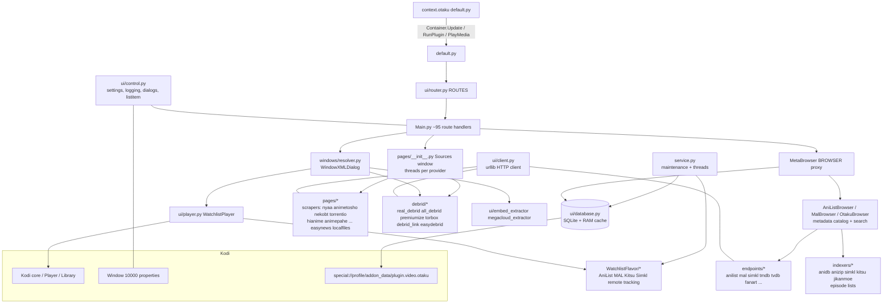

# Otaku code architecture (research notes)

Source: Goldenfreddy0703/Otaku HEAD `420666d` (2026-09-18), plugin.video.otaku 5.3.3, context.otaku 1.0.35.
Paths below are relative to `plugin.video.otaku/` unless stated. Line numbers refer to that commit.
Research only; no Otaku code was executed (SQLite `info.db` was opened read-only to read its schema).

## 1. Entry points

| Entry | File | What it does |
|---|---|---|
| Plugin (every `plugin://plugin.video.otaku/...` URL) | `default.py` (addon.xml `xbmc.python.pluginsource`) | Imports `resources.lib.Main` (which registers routes as import side effect), parses `sys.argv`, calls `router_process(url, params)` (`default.py` ~L28-33). If `ADDON_VERSION != setting 'version'` it shows a changelog window first. |
| Service (runs at Kodi start) | `service.py` (addon.xml `xbmc.service`) | Maintenance + prefetch, see section 9. |
| Context menu | `../context.otaku/default.py` (addon.xml `kodi.context.item`, 12 items) | Thin: reads the focused `ListItem` (`sys.listitem`), builds a `plugin://plugin.video.otaku/...` URL and fires `Container.Update`, `RunPlugin` or `PlayMedia` builtins (L66-107). It never imports Otaku code; it round-trips through the plugin URL. Visibility is driven by Window(home) properties that the main add-on writes from settings (`control.process_context`, `ui/control.py` L381-408). |
| Settings actions | `resources/settings.xml` action buttons call `RunPlugin(plugin://plugin.video.otaku/<route>)` | Same router; e.g. `rebuild_database`, `clear_cache`, `toggleLanguageInvoker` (`Main.py` L1837-2436). |

The context add-on also ships `info.db` (a SQLite file with 14 rows of API client IDs/keys: `api_name, api_key, client_id, client_secret, description`). Otaku reads it via `database.get_info()` (`ui/database.py`) and `control.infoDB` (`ui/control.py` L72). Shipping keys in the add-on means they are public to anyone who unzips it. I did not print any values.

## 2. URL routing

Decorator-based, linear scan, no dispatch dict.

- `ui/router.py` (whole file, 41 lines): `ROUTES = []` list; `class Route` stores a path string and a `wildcard` flag if it ends in `*`; `__call__` appends itself to `ROUTES`. `multi_route(*paths)` registers one handler for many paths. `router_process(url, params)` loops over `ROUTES` and calls the first route where `url == path` or (wildcard and `url.startswith(path)`) with `(payload, params)`. `payload` is the URL path with the first segment stripped.
- Quirk: first match wins and matching is O(n) over ~95 `@Route`/`@multi_route` decorators (`grep -c` on `Main.py`). Wildcard prefixes are plain `startswith`, so route ordering matters (e.g. `animes/*` vs others).
- All handlers live in one 2,436-line file, `resources/lib/Main.py`; the docstring says this is deliberate ("single import surface", L19-20). Many routes are generated programmatically (`_browser_list_route_paths`, L52+; 7 media formats x ~30 list types).
- Typical handler signature: `def PLAY(payload, params)` (`Main.py` L1155-1156). `payload` e.g. `"<mal_id>/<episode>"`; `params` = parsed query string (`control.get_plugin_params`, `ui/control.py` L436).
- Primary key everywhere is the MAL ID: `animes/<mal_id>/`, `play/<mal_id>/<ep>`, `play_movie/<mal_id>/<n>` (`Main.py` L1155-1160, 1236).

Lesson for a custom add-on: a dict dispatch (`{path: handler}`) plus a small prefix table is simpler to test than a list-of-objects scan.

## 3. Layers

### 3.1 Metadata providers vs scrapers vs debrid

- Metadata (catalogs, search, episode lists, art): `AniListBrowser.py`, `MalBrowser.py`, `OtakuBrowser.py` (selected by setting `browser.api`, lazy singleton in `MetaBrowser.py` L8-32); HTTP wrappers in `endpoints/` (anilist, mal, simkl, tmdb, tvdb, fanart, mdblist, anidb, aniskip, anime_skip, anime_filler, malsync, animeschedule, teamup); per-episode indexers in `indexers/` (anidb, anizip, simkl, kitsu, jikanmoe, otaku). `MAL_API_BASE_URL = "https://api.tenrai.org/v1"` (`ui/control.py` L78) is a third-party Jikan-compatible host (single point of failure).
- ID mapping: MAL ID is the pivot. A downloaded `mappings.db` (see 6.4) maps MAL to AniList/Kitsu/Simkl/AniDB/TMDB/TVDB/IMDB. `database.get_mappings/get_unique_ids/get_mal_ids` (`ui/database.py` L424-460).
- Scrapers (`pages/`): torrent (nyaa, animetosho, nekobt, torrentio), hoster (easynews), embed/streaming sites (animepahe, animixplay, hianime, anikoto, watchnixtoons2; animekai/aniwave/gogoanime exist but commented out in the provider table, `pages/__init__.py` L28-34), cloud (`debrid_cloudfiles`), local (`localfiles`). Orchestrated by `class Sources(GetSources)` (`pages/__init__.py` L48+): one `threading.Thread` per enabled provider (`_start_worker`, L77-80), results merged into torrent/hoster/embed/cloud lists, then filtered/sorted (`ui/source_utils.py`, `windows/sort_select.py`).
- Debrid (`debrid/`): `Debrid.torrentCacheCheck` (`debrid/__init__.py` L1-60) starts a thread per enabled service and `join()`s them. Each service class (e.g. `RealDebrid`, `debrid/real_debrid.py`) does OAuth device flow, token refresh, instant-availability check, add-magnet, select-files, unrestrict link. Real-Debrid base URLs L19-20.

### 3.2 Playback resolution

1. `PLAY` route (`Main.py` L1155) loads episode metadata (pickled dict from DB), optionally asks "Resume from X / Play from beginning" using the `resume` URL param (L1209-1217).
2. `MetaBrowser.get_sources()` (`MetaBrowser.py` L93) runs the Sources window (a modal `WindowXMLDialog` progress UI, `windows/get_sources_window.py`).
3. Depending on settings (`general.smartplay`, `general.playstyle.episode`), either `SourceSelect` (user picks) or `Resolver` (auto) modal windows run (`Main.py` L1227-1275).
4. `Resolver._handle_playback` (`windows/resolver.py` L198-300) builds an `xbmcgui.ListItem`, applies subtitles, mimetype hooks, video tags (`control.set_videotags`), then either:
   - `xbmc.Player().play(playList, item)` for context-menu/widget launches (no valid plugin handle), or
   - `xbmcplugin.setResolvedUrl(HANDLE, True, item)` for in-add-on launches (L265-272).
5. It then spins up `WatchlistPlayer().handle_player(...)` (`ui/player.py` L73) which blocks until playback ends.
6. InputStream Adaptive hooks for DASH/HLS are registered by mimetype decorator (`windows/resolver.py` L515-567), branching on `control.kodi_version` (<20.9, >21.8) for property names.
7. Auto-next: `build_playlist()` (`ui/player.py` L145+) adds following episodes to the Kodi playlist; each is a `plugin://.../play/...` URL so the full resolve cycle repeats per episode.

Design cost: because resolve happens inside a long-running modal window plus a player loop in the plugin invocation, `reuselanguageinvoker` is fragile (see section 12).

## 4. Data models

No dataclasses or typed models. Everything is plain `dict`:

- List item descriptor: `utils.allocate_item()` returns `{'isfolder','isplayable','name','url','info','cm','image':{poster,icon,thumb,fanart,landscape,banner,clearart,clearlogo}}` (`ui/utils.py` L41-65).
- `kodi_meta` per show/episode: a free-form dict (title_userPreferred, plot, mpaa, duration, genre, studio, status, mediatype, rating, cast, year, premiered, episodes, eps_watched ...) serialised with `pickle.dumps` into SQLite BLOBs (e.g. `ui/database.py` L324-340; reads via `pickle.loads` in `Main.py` L331, L1188).
- `UniqueIDs` dict: `{'mal_id', 'anilist_id', 'kitsu_id', 'simkl_id', 'imdb', 'tmdb', ...}` passed to `InfoTagVideo.setUniqueIDs` (`ui/control.py` L590-597).
- Source dict: free-form (`type`, `provider`, `quality`, `hash`, `magnet`, `size`, ...), see `pages/` modules.

Consequences: fast to write, but schema is implicit, and pickled blobs are version-fragile. That is why Otaku force-rebuilds the DB on schema bumps (section 6.3). A rewrite should use explicit schemas (JSON/typed columns).

## 5. Settings access

- Declared in `resources/settings.xml` (new Kodi 18+ format, ~4,000+ lines; levels used to hide internal settings; internal state also lives in settings, e.g. `realdebrid.token` level 4, `settings.xml` L4157-4178, `update.time.*`, `addon.last_watched`).
- Wrapper layer in `ui/control.py` L200-370: `getSetting/getBool/getInt/getStr/getNumber/get*List` with a 3-tier read: Window(10000) property `"{ADDON_ID}_{key}"` then module dict `_settings_cache` then `xbmcaddon.Settings` API. Writers `set*` evict cache (`_evict_setting`, L315).
- The service pre-loads all settings into Window properties (`service.load_settings`, `service.py` L252-294) and refreshes on `Monitor.onSettingsChanged` (L297-304) when `general.kodi.cache` is on. This cuts per-call overhead in short-lived plugin processes at the price of stale-cache bugs.
- Lists (menus, embed servers, fanart selections) are stored as Kodi `list[string]` settings.
- Secrets (tokens) are ordinary string settings; see platform_compatibility.md for the security implications.

## 6. Persistence

All files under `special://profile/addon_data/plugin.video.otaku/` (`control.dataPath`, `ui/control.py` L64) except `info.db` (inside the context add-on folder, read-only data).

### 6.1 SQLite databases

`SQL` context manager (`ui/database.py` L42-96): `sqlite3.connect(path, timeout=30, isolation_level=None)`, `row_factory` = dict, pragmas `foreign_keys=ON`, `synchronous=OFF`, `journal_mode=WAL`, `mmap_size=256MB` (L65-68). Swallows `OperationalError` after logging (L90-95), meaning failed writes can be silent. `synchronous=OFF` risks corruption on power loss (relevant on Fire TV sticks which are often hard-unplugged).

| File | Defined | Tables / schema |
|---|---|---|
| `malSyncDB` = `malSync.db` | `ui/database_sync.py` L54-189 | **activities**(sync_id INTEGER PK, otaku_version TEXT NOT NULL). **shows**(mal_id INTEGER PK, anilist_id, simkl_id, kitsu_id INTEGER, kodi_meta BLOB NOT NULL, anime_schedule_route TEXT NOT NULL; unique idx ix_shows). **shows_meta**(mal_id PK, meta_ids BLOB, art BLOB). **episodes**(mal_id INTEGER NOT NULL FK->shows ON DELETE CASCADE, season INTEGER NOT NULL, kodi_meta BLOB NOT NULL, last_updated TEXT NOT NULL, number INTEGER NOT NULL, filler TEXT, anidb_ep_id INTEGER; unique idx (mal_id,season,number)). **show_data**(mal_id PK, data BLOB NOT NULL, last_updated TEXT NOT NULL). **watchlist_cache**(id AUTOINCREMENT PK, service, status, mal_id, item_order, data BLOB, last_updated INTEGER; UNIQUE(service,status,item_order); 2 indexes). **watchlist_activity**(service PK, activity_timestamp TEXT, last_checked INTEGER). **anilist_enrichment**(mal_id PK, data BLOB, last_updated INTEGER). |
| `cacheFile` = `cache.db` | `ui/database.py` L149-160 | **cache**(key TEXT UNIQUE, value TEXT, date INTEGER) + unique idx ix_cache. Values stored as `repr()` strings and read back with `ast.literal_eval` (L186-195). |
| `searchHistoryDB` = `search.db` | `ui/database.py` L675-730 | 8 tables `anime, movie, tv_show, tv_short, special, ova, ona, music`, each `(value TEXT UNIQUE)`. Table names are interpolated into SQL via f-strings from an allow-list. |
| `mappingDB` = `mappings.db` | downloaded, not created by add-on | Schema not in this repo; it is fetched from `github.com/Goldenfreddy0703/Otaku-Mappings/raw/.../anime_mappings.db` and written to disk with no integrity check (`service.py` L54-63). |
| `info.db` | shipped in context.otaku | Table `info` (see section 1). |

### 6.2 JSON / other files (`ui/control.py` L87-94)

`mal_dub.json` (weekly refresh of MAL-Dubs list, `service.py` L173-183), `downloads.json`, `completed.json`, `genres.json`, `sort_options.json`, `watch_history.json`, `embeds.json`, `animeschedule_calendar.json`, `qr_code.png` (Real-Debrid QR), cookie text files per domain (`ui/client.py` ~L340-347), `settings.xml` (Kodi-managed).

### 6.3 Versioning, rebuild, cleanup

- `SyncDatabase.SCHEMA_VERSION = '1.0.13'` (`database_sync.py` L30). Startup (`service.py` L313) creates tables (all `IF NOT EXISTS`), reads `activities.otaku_version`, and on mismatch calls `re_build_database(True)` (L205-225). The only in-place migration is `watchlist_cache`: if `item_order` column missing, DROP and recreate (L143-151).
- `re_build_database` (L297-320): redownloads mappings + dub list, **truncates `malSync.db` by reopening it with mode `'w'`** (L309-310), recreates tables, stamps version. No backup, no export.
- Other bundled clean-up: `database.cache_clear()` (drops `cache` table, `VACUUM`, clears watchlist/activity/enrichment; `ui/database.py` L281-300) via route `clear_cache`; `control.clear_settings()` = `shutil.rmtree(dataPath)` (`ui/control.py` L829-843) via route `wipe_addon_data`; `clear_watch_history` deletes `watch_history.json` (`Main.py` L1881-1895); search-history clears drop tables.
- Settings migration: version-gated one-off code in `database_sync.check_database_version` (rewrites menu config lists, resets embed list, L205-269) and `service.version_check` (L238-249). `import_settings/export_settings` routes just copy `settings.xml` (`Main.py` L1949-1990). Not a general migration framework.
- Sharp edge: because per-episode watched count (`eps_watched`) lives in `shows.kodi_meta` (6.5 below), any schema bump or "Rebuild database" wipes local progress for users not logged into a tracker.

### 6.4 Caches and invalidation

3-tier `database.get(function, hours, *args)` (`ui/database.py` L166-207): (1) Window(10000) property with expiry `"{epoch}|{repr}"` (L105-123), (2) SQLite `cache`, (3) call the function. TTL is passed per call site in hours; key is `function name + md5(args)`. Cache entries are never purged by age (only overwritten or cleared wholesale), so `cache.db` grows. Watchlist cache is invalidated by 24 h age (`is_watchlist_cache_valid`, L558) and by remote "activity timestamp" comparisons (`watchlist_activity`). AniList enrichment max age 168 h (L638). RAM cache lives in Window properties, which are cleared on Kodi restart.

### 6.5 What is "history"? Four separate things

| Concept | Where | Notes |
|---|---|---|
| **Local progress / watched count** | `shows.kodi_meta['eps_watched']` (pickle in `malSync.db`), written in `WatchlistFlavor.watchlist_update_all_episodes` (`WatchlistFlavor/__init__.py` L164-185) *before* any tracker call, so it works with no tracker. Triggered at `watchlist.update.percent` of playback (`ui/player.py` L176-193, polls every 10 s). Episode listings read it to draw watched marks (`indexers/anidb.py` L117, L195-199). If unset and `interface.watchlist.data` is on, falls back to the remote tracker's count (`indexers/anidb.py` L195-199). | Per-show integer only, no per-episode timestamps, no rewatch count. |
| **Last watched** (menu shortcut) | setting `addon.last_watched` (MAL ID), `ui/player.py` L231-236; rendered by `Main.add_last_watched` (L314-377) | One show only. Cleared on schema bump (`database_sync.py` L228). |
| **Watch history list** | `watch_history.json`: `{'history':[entry,...]}` newest first, one entry per show, containing a full copy of metadata and art (`Main.save_to_watch_history`, L415-485) | Survives DB rebuild; deleted only by `clear_watch_history`. |
| **Resume point** | Kodi's own video DB, keyed by the playing file path. Otaku writes it via JSON-RPC `Files.SetFileDetails` with `resume{position,total}` on stop if watched percent is between 10 and 90 and playback was context-launched (`ui/player.py` L116-134). In-add-on launches rely on Kodi's native resume for the plugin URL. A `resume` URL param is turned into `vinfo.setResumePoint` (`ui/control.py` L600-601) and into a "Resume from" prompt (`Main.py` L1209-1217). | Because the key is the plugin URL (`plugin://.../play/<mal_id>/<ep>`), resume survives only while that URL is stable. |
| **Remote tracking** | `WatchlistFlavor/{AniList,MyAnimeList,Kitsu,Simkl}.py` classes with `update_num_episodes`, `update_list_status`, `update_score`; status mapping `_STATUS_MAP` (`WatchlistFlavor/__init__.py` L8); fan-out to all enabled services in `watchlist_update_all_episodes` (L164-228) with auto-complete when `episode >= total and finished_airing`. Plus Trakt via the separate Trakt script's window property (`script.trakt.ids`, `ui/player.py` L224-228) | Optional. Tokens refreshed by `service.refresh_apis` (`service.py` L12-42). Watchlist lists are cached locally in `watchlist_cache` for speed. |
| **Next Up** | `indexers/otaku_next_up.py` (API-based: Simkl/AniZip/Kitsu/Jikan episode metadata fetches) and watchlist "CURRENT" entries; menu item gated on `watchlist.update.enabled` and `nextup.enabled` (`Main.add_next_up`, L307-311). | Depends on a tracker watchlist, i.e. needs remote login (`WatchlistIntegration.py` L44-60). No tracker-free next-up. |
| **Favorites / bookmarks** | Not implemented locally. "favourites" routes are ranked-by-popularity browse lists (`OtakuBrowser.py` L527-539). Favorites in the user sense are the tracker watchlist (plan-to-watch etc.). | A personal add-on needs its own table. |

## 7. Logging

`control.log(msg, level='debug')` (`ui/control.py` L131-142) maps to `xbmc.log` with `"OTAKU ({HANDLE}): msg"`. **Default level is debug**; Kodi only emits it if debug logging is on. No redaction layer exists. Spot checks: logs include scraper URLs (e.g. `pages/animekai.py` L321, `pages/watchnixtoons2.py` L584), `plugin_url` + `plugin_params` after every route (`default.py` end), and Python/SQLite/Kodi versions at startup (`service.py` L238-243). Token values are not logged in the Real-Debrid refresh path (`debrid/real_debrid.py` L168 logs only the fact). `client.request` can send `Authorization: Bearer <token>` headers (`real_debrid.headers`), and I did not find them logged, but nothing prevents an exception message or URL with an API key query parameter from reaching the log. Treat Kodi logs as sensitive when sharing.

`control.print()` and `timeIt` helpers exist for development (`ui/control.py` L917-933).

## 8. HTTP layer

`ui/client.py` (1,143 lines): a requests-shaped facade (`client.get/post` return `Response` with `.json()`, `.text`, `.ok`, `.status_code`) built on `urllib.request` + `http.cookiejar`. Includes TLS context selection (TLS 1.1/1.2/auto), custom CA file `special://xbmc/system/certs/cacert.pem` (`L44`), per-request `verify` toggle (`verifypeer=false` hack, L203), Cloudflare/DDoS-Guard challenge handling, session/cookie caching in memory with 10 min TTL (L48-61), UA caching. It does not import `requests`, so there is no `script.module.requests` dependency. The Cloudflare bypass code is the largest single scraper-specific complexity; a debrid-only personal add-on can drop it.

## 9. Background tasks (`service.py`)

On every Kodi start (`service.py` L307-340):
1. `load_settings()` if `general.kodi.cache` (settings to Window props).
2. `control.process_context()`.
3. `version_check()` logs env and re-applies `reuselanguageinvoker` state (see 12).
4. `database_sync.SyncDatabase()` (table creation, version check, possible rebuild with dialogs).
5. `refresh_apis()`: refresh Real-Debrid, Debrid-Link, Kitsu, MAL tokens if expiring within 600 s (L12-42). Runs only at startup; no periodic refresh while Kodi stays up for days (the `Monitor` only waits for abort). RD tokens are also refreshed lazily elsewhere, not verified here.
6. Timed jobs using settings `update.time.30/7/1`: mappings.db monthly, dub JSON weekly, watchlist sync daily/weekly (L315-333). The `update_calendars` job is commented out.
7. Two daemon threads: `prefetch_watchlist` (L90-158) and `prefetch_calendar` (L161-170).
8. If `general.kodi.cache` then `Monitor().waitForAbort()` keeps the service alive; otherwise the service script exits after startup.

## 10. Threading

- `threading.Thread` per scraper/debrid worker with `join()` (`pages/__init__.py` L77-80; `debrid/__init__.py` L18-52).
- `ThreadPoolExecutor` for parallel metadata fetches (`ui/utils.py` L218, L256; `ui/control.py` L800 for ListItem building).
- Daemon threads for skip-time lookup (`ui/player.py` L97-112) and service prefetch.
- SQLite is opened per call in WAL mode, which is what makes multi-thread use workable (`ui/database.py` L55-68).
- Kodi API calls from worker threads (setProperty etc.) are generally tolerated but not formally thread-safe.

## 11. Player integration

- `WatchlistPlayer(xbmc.Player)` subclass with `onPlayBackStopped/Ended/Error` (`ui/player.py` L116-143) and a polling loop `keepAlive` (L195+) waiting up to 40 x 0.5 s for playback start, seeking to `resume`, setting audio/subtitle preferences, skip-intro/outro dialogs (AniSkip, AnimeSkip, embed-provided times, ffprobe chapter markers: `ui/ffprobe_chapters.py`).
- Playback-error detection through `xbmc.Monitor.onNotification` (`ui/player.py` L770+, `windows/resolver.py` L492-512).

## 12. reuselanguageinvoker

`addon.xml` ships `<reuselanguageinvoker>false</reuselanguageinvoker>` with an inline comment: enabling gives "much faster menu speeds" but "expect some instability" (`plugin.video.otaku/addon.xml` L15). Otaku lets the user toggle it from the UI: `service.toggle_reuselanguageinvoker` (`service.py` L214-235) **edits the installed `addon.xml` on disk with string replacement** (`"true"`/`"false"`) and then calls `LoadProfile` to reload. `version_check` re-applies the user's choice after each update (L245-249), since an update overwrites `addon.xml`. `control.exit_code()` calls `sys.exit(0)` only when the invoker is reused (`ui/control.py` L448-450), to end the script cleanly. Risks: modifies add-on files in place (may be read-only on some platforms; also breaks add-on file hash/updates in repos that verify), module-level state persists between plugin calls (e.g. `_settings_cache`, `_tables_ready`, `BROWSER` singleton), and Window properties used as cache must be coordinated. For a custom add-on, leave it `false`, or design explicitly for it.

## 13. Kodi API version handling

- Uses the Kodi 20+ `InfoTagVideo` setters (`li.getVideoInfoTag()`, `vinfo.setTitle`, `setUniqueIDs`, `setResumePoint` ...) in `ui/control.py` L543-601; `setInfo()` is not used (grep). Context add-on uses `getVideoInfoTag()` getters (`../context.otaku/default.py` L8-20).
- Hard minimum: `xbmc.python 3.0.1` (Nexus and Omega) in addon.xml; README says Kodi 20+. `kodi_version = float(addon_version[:4])` is used for ISA property differences only (`ui/control.py` L65; `windows/resolver.py` L523-561).

## 14. Tests and testability

- No test directory, no pytest/unittest files, no CI config in the repo tree (`find -iname "*test*"` returns only icons/images and `sync_to_testing.py`, a dev script that copies files to a separate testing add-on folder). 955 commits, no automated tests found.
- Dev scripts only: `sync_to_testing.py` (hard-coded Windows path of the maintainer), `renumber_string_ids.py`, `cleanup_whitespace.py`, `symbolic_string.py` (language-string tooling).
- Testability assessment: poor. Nearly every module imports `xbmc`, `xbmcgui`, `xbmcaddon`, `xbmcvfs`, or `ui.control` at import time (which itself constructs `xbmcaddon.Addon()` objects and Window(10000) at module level, `ui/control.py` L55-100). Business logic (source filtering, quality regex in `ui/source_utils.py`, status mapping) is fairly pure and could be tested if Kodi modules are stubbed. Global singletons, `sys.argv` parsing at import time (`Main.py` L34-35), module-level DB paths, and long handlers with inline UI make unit testing hard. For a new add-on: keep a thin Kodi adapter layer; put pure logic (ID mapping, source ranking, progress tracking, SQLite access with injectable path) in plain modules; test with stub `xbmc*` modules or `Kodistubs` (a PyPI stub package by Roman Miroshnychenko, not verified here).

## 15. Distinguishing the three kinds of "state"

| | Otaku local DB | Remote tracker | Kodi resume |
|---|---|---|---|
| Purpose | metadata cache + `eps_watched` + history JSON | AniList / MAL / Kitsu / Simkl list status, progress, score | Position in a specific playing URL |
| Location | add-on `addon_data` | cloud | Kodi `MyVideos` DB (outside add-on control) |
| Required? | yes | no (but Next Up needs it) | automatic |
| Survives Otaku DB rebuild | `watch_history.json` yes; `eps_watched` no | yes | yes (until Kodi library cleaned) |
| For user's goal (local-only) | adapt: you must own a real progress table | omit | still useful for resume |

## 16. Takeaways for a personal add-on

1. Keep: MAL/AniList ID as pivot (via a mapping table), thin router, debrid device-flow pattern, ISA hooks per mimetype, `setResolvedUrl` with plugin handle, Kodi-native resume.
2. Avoid: pickled blobs, silent `OperationalError` swallowing, `synchronous=OFF`, truncating the only copy of user progress on schema bump, in-place `addon.xml` rewrites, Cloudflare bypass, unverified downloads of data files (`mappings.db` over HTTPS with no hash).
3. Add: a proper local progress table (mal_id, episode, position, duration, updated_at, watched flag) with migrations, local favorites, token-refresh scheduling in the service loop, log redaction.
