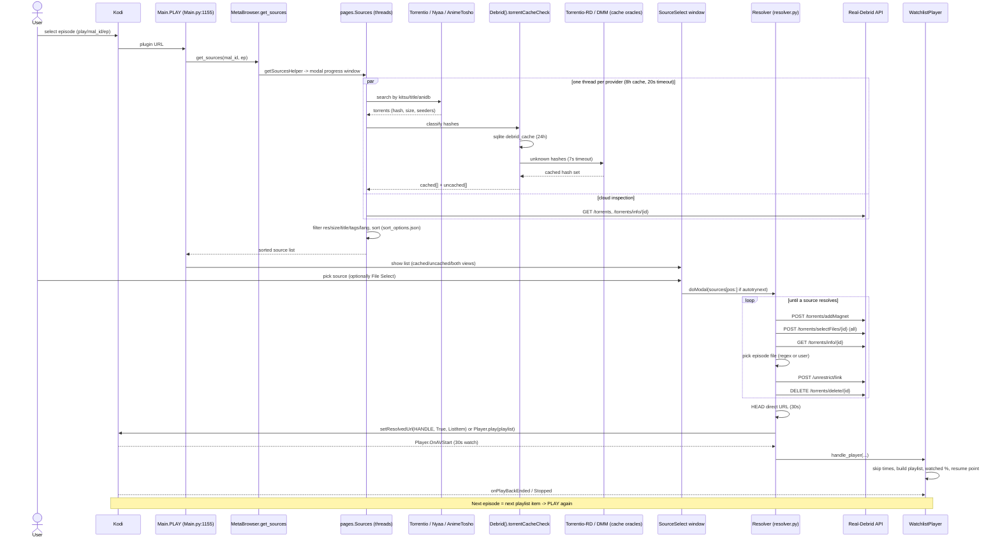

# Otaku playback trace (anime selected -> playing -> done)

Reference: Goldenfreddy0703/Otaku, HEAD 420666d, plugin.video.otaku v5.3.3.
All paths below are relative to `plugin.video.otaku/resources/lib/` unless noted. Read-only static analysis; nothing was executed.
Legend: CONFIRMED = read in source (file:line). ASSUMPTION = inferred, not verified.

Related docs: `source_discovery_options.md`, `reference_comparison.md`, `real_debrid_analysis.md` (same folder).

---

## 0. Scraper split (what the user cares about vs not)

Registered in `pages/__init__.py:16-39` (CONFIRMED).

| Group | Providers | Output | Needs debrid? |
|---|---|---|---|
| Torrent-indexer (feed debrid) | `nyaa` (HTML scrape), `animetosho` (HTML scrape), `nekobt`, `torrentio` (Stremio JSON API) - `pages/__init__.py:16-21` | `{'cached': [...], 'uncached': [...]}` of `type: 'torrent'` dicts holding an infohash | YES. Only started if `debrid_on` - `pages/__init__.py:107-114` |
| Debrid-account inspection | `debrid_cloudfiles` ("Cloud Inspection"): lists files already in user's RD/PM/AD/TB cloud - `pages/debrid_cloudfiles.py:35-73` | `type: 'cloud'` | YES |
| Hoster | `easynews` (usenet host, own creds) - `pages/__init__.py:25-27` | `type: 'hoster'` | No (own account) |
| Direct-streaming sites (embed extractors) | `animepahe`, `animix`, `hianime`, `anikoto`, `watchnixtoons2` active; `aniwave`, `animekai`, `gogoanime` commented out/unused - `pages/__init__.py:31-39` | `type: 'embed'`/`'direct'`, URL resolved by `ui/embed_extractor.py` | No |
| Local | `localfiles` | `type: 'local'` | No |

Debrid path only = nyaa + animetosho + torrentio (+ nekobt, default off) + cloud inspection. The rest can be ignored for a RD-only add-on. Defaults: `provider.torrentio`, `provider.nyaa`, `provider.animetosho` = true; `provider.nekobt` = false (`settings.xml:804, 758, 771, 799`).

---

## 1. User selects an anime

- Kodi calls plugin URL `plugin://plugin.video.otaku/animes/<mal_id>/<eps_watched>`.
- Entry: `default.py` (addon root, `plugin.video.otaku/default.py:19-30`) -> `ui/router.py: router_process` -> `@Route('animes/*')` `ANIMES_PAGE` at `Main.py:521-525`.
- Inputs: `mal_id` (MyAnimeList id is the primary key everywhere), `eps_watched`.
- Calls `MetaBrowser.get_anime_init(mal_id)` (`MetaBrowser.py:35-90`): checks sqlite `shows`/`shows_meta`; on miss `BROWSER.get_anime(mal_id)` (AniList/MAL/Otaku API chosen by setting `browser.api`, `MetaBrowser.py:9-22`); then episode list via fallback chain simkl -> anizip -> jikanmoe -> anidb -> kitsu (`MetaBrowser.py:73-89`).
- Output: list of Kodi directory items drawn by `control.draw_items(anime_general, 'episodes')` (`Main.py:525`, `ui/control.py:719`).
- External services: MAL/AniList metadata APIs, Simkl, AniZip, Jikan-compatible (tenrai), AniDB, Kitsu. Not needed for playback of an RD add-on beyond id mapping.
- Errors: returns `[], 'episodes'` if show cannot be built (`MetaBrowser.py:46-47`).

## 2. Episode identified

- Each episode item is built with URL `play/<mal_id>/<episode>` (`indexers/__init__.py:94`, `utils.allocate_item(title, f"play/{url}", False, True, ...)`). Episode metadata is pickled into sqlite (`database.update_episode`, `indexers/__init__.py:96-98`).
- On click Kodi invokes `plugin://.../play/<mal_id>/<episode>[?source_select=true|rescrape=true|resume=N]`.
- `@Route('play/*') PLAY` at `Main.py:1155-1256`:
  - parses `mal_id, episode = payload.rsplit("/")`; reads params `source_select`, `rescrape`, `resume` (`Main.py:1157-1162`).
  - reloads episode metadata dict from sqlite (`database.get_episode`), falling back to show metadata (`Main.py:1168-1199`).
  - if `resume`, shows context menu "Resume from ... / Play from beginning" (`Main.py:1201-1208`).
- Season/part resolution for scraper query: `MetaBrowser.get_sources` pulls `season` from the episode row and `thetvdb_part` from mappings (`MetaBrowser.py:99-106`).
- Movies: `@Route('play_movie/*')` `Main.py:1259-1310` - same flow with `media_type='movie'`, episode=1.

## 3. Discovery initiated

- `Main.py:1210` `sources = MetaBrowser.get_sources(mal_id, episode, 'show', rescrape, source_select)` -> `MetaBrowser.py:93-124`.
- Builds `actionArgs = {query, mal_id, episode, episodes, status, duration, media_type, rescrape, source_select, silent, season, part}`; `query` is the show title string from `kodi_meta['query']` (a pre-built `(title1)|(title2)` style sphinx query - ASSUMPTION from nyaa.py:34-36 `split('|')`).
- Calls `pages.getSourcesHelper(actionArgs)` (`pages/__init__.py:42-47`): opens modal progress window `get_sources.xml` (or `_alt` skin) class `Sources(GetSources)` and returns its `doModal()` value = the sorted list of sources (or `[]`).
- `Sources.getSources` (`pages/__init__.py:83-175`) spawns one **Python thread per provider** (`_start_worker`, `pages/__init__.py:77-81`):
  - torrent providers (only when some debrid is enabled AND `provider.<name>` true) `pages/__init__.py:110-114`;
  - easynews hoster `116-121`;
  - cloud inspection when a debrid is enabled for both "debrid" and "cloud" `123-126`;
  - local files `128-131`;
  - embed providers `133-141`.
- Timeout/wait loop `pages/__init__.py:143-168`: `timeout = 60 if rescrape else control.getInt('general.timeout')` (default **20 s**, `settings.xml:978-980`). Polls every 500 ms (`control.sleep(500)`), breaks on cancel, on all providers done (`remainingProviders` empty), or early exit when `general.terminate.oncloud`/`onlocal` and a cloud/local hit exists (default false). Threads are NOT killed at timeout; whatever lists are filled so far are used (results appended by workers into shared lists, `pages/__init__.py:187-189`).
- Caching: each provider call is wrapped in `database.get(fn, 8, *args, key=cache_key)` = 3-tier cache RAM -> sqlite `cache` table -> live call, **8 hours** (`pages/__init__.py:184`, `ui/database.py:166-206`). `rescrape` bypasses the cache (`pages/__init__.py:181-182`). A `None` result is not cached (`database.py:202-203`).
- Failure mode (CONFIRMED by reading, behaviour inferred): a worker that raises never removes itself from `remainingProviders` (`remainingProviders.remove(...)` is the last statement, e.g. `pages/__init__.py:190`), so the loop waits for the full timeout. No try/except around the worker bodies at this level.

## 4. Sources retrieved (torrent-indexer path)

### 4a. Torrentio (`pages/torrentio.py`)
- Requires a `kitsu_id` from the id-mapping table; otherwise logs and returns empty (`torrentio.py:28-34`).
- GET `https://torrentio.strem.fun[/providers=...]/stream/series/kitsu:<kitsu_id>:<ep>.json` timeout 30 s (`torrentio.py:51-57`). Note: **no debrid key in this URL** - it returns raw torrents (`infoHash`) and does not tell cached state.
- Parses `streams[]`: infoHash, first title line, `behaviorHints.filename`, seeders from the 👤 emoji, size regex (`torrentio.py:121-152`). Builds a bare magnet `magnet:?xt=urn:btih:<hash>&dn=<name>`.
- `source_utils.filter_sources('torrentio', ...)` filters by season/episode/part regexes (`ui/source_utils.py:452+`).

### 4b. Nyaa (`pages/nyaa.py`) and AnimeTosho (`pages/animetosho.py`)
- HTML scraping with BeautifulSoup (`nyaa.si`, `animetosho.org`; optional google-translate proxy mirrors, `nyaa.py:11`, `animetosho.py:15`).
- Up to 4 parallel searches per provider (primary episode, batch/complete for finished shows, fallback unsorted, season variation): `nyaa.py:35-115`, `animetosho.py:61-137`. Plus a "show-level" search for batch packs (`nyaa.py` `get_show_sources`; `animetosho.py:147-163`). AnimeTosho adds `aids=<anidb_id>` narrowing (`animetosho.py:75-76`).
- Magnets/hash taken from page; AnimeTosho derives hash from torrent URL or base32 magnet (`animetosho.py:208-217`).
- Each provider then calls `Debrid().torrentCacheCheck(filtered_list, ...)` (`animetosho.py:219`, `torrentio.py:74`).

### 4c. Cache classification (the "is it cached on RD" step) - `debrid/__init__.py`
- `torrentCacheCheck` spawns one thread per enabled debrid and joins them (`debrid/__init__.py:23-60`).
- `real_debrid_worker` (`debrid/__init__.py:123-154`):
  1. local sqlite `debrid_cache` table lookup, 24 h TTL (`debrid/debrid_cache.py:24-60`);
  2. for unknown hashes, needs an IMDb id from mappings (`debrid/__init__.py:62-81, 138-139`) - **if no imdb_id, no external check runs and all unknown hashes become "uncached"** (CONFIRMED: `external_cached` stays empty);
  3. `check_rd_cache` -> two third-party checks in parallel (`debrid_cache.py:76-87`): Torrentio query *with an embedded RD credential in the URL* (`_tio_check_cache`, `debrid_cache.py:103-125`), and Debrid Media Manager `POST https://debridmediamanager.com/api/availability/check` with a locally computed anti-bot "solution" (`debrid_cache.py:176-207, 216-254`). Timeout 7 s each.
  3. results saved to sqlite in a background thread.
- RD's own instantAvailability is NOT used any more (removed in commit fbc473b, v5.2.85-86, 2026-04-05; see `real_debrid_analysis.md`).
- After classification, cached list sorted by seeders (torrentio) / downloads (animetosho); uncached list kept only if `seeders > 0` (`torrentio.py:75-78`, `animetosho.py:220-223`) and only appended when `show.uncached` setting is true (default **true**, `settings.xml:1018-1020`).
- `parse_*_view` converts to the normalized dict (step 5). Duplicates removed by `(hash, debrid_provider)`, higher seeders wins (`torrentio.py:188-210`).

### 4d. Cloud inspection (`pages/debrid_cloudfiles.py:35-73`)
- `GET /torrents` (user's RD list) -> fuzzy match title against filenames -> `GET /torrents/info/{id}` per match -> builds `type: 'cloud'` dicts carrying `torrent_info` (links[]) so resolution later needs no addMagnet. Skips multi-file entries with a single link (`debrid_cloudfiles.py:47-48`).

### 4e. Embed/direct (not debrid) - for completeness
- `_embed_sources_worker` (`pages/__init__.py:210-225`); resolution of embeds in `windows/resolver.py:156-161` via `ui/embed_extractor.load_video_from_url`. These also feed skip-intro timestamps (`_apply_embed_skip`, `pages/__init__.py:235-247`).

## 5. Normalization, filtering, sorting, presentation

### Normalized source dict (from `torrentio.py:155-186`)
`release_title, hash, filename, type ('torrent' | 'torrent (uncached)'), quality (0-4 int), debrid_provider, provider, episode_re, size (string), byte_size, info (tag list), lang (0-3), channel, sub, cached (bool), seeders`, and `magnet` only for uncached.
- Quality: substring match 4k/2160 -> 4, 1080 -> 3, 720 -> 2, else 1 (`ui/source_utils.py:193-204`); `res = ['EQ','480p','720p','1080p','4k']` (`source_utils.py:26`).
- Audio lang code: 0 multi-audio, 1 dual-audio, 3 dub, 2 default (sub) (`source_utils.py:158-168`). Sub: 0 multi-sub else 1 (`184-190`). Channels (`171-181`). Info tags HEVC/AVC/REMUX/BATCH etc. (`_INFO_TAGS`, `source_utils.py:206-265`). All derived from release-title string heuristics.

### Filtering and sorting - `Sources.sortSources` (`pages/__init__.py:249-367`), executed after the wait loop (`pages/__init__.py:170-173`)
Order:
1. Resolution window `general.minResolution`..`general.maxResolution` (defaults 0..4) `:252`.
2. Size filter `general.fileFilter`: 0 off; 1 web-speed cap (bitrate vs `general.webspeed`); 2 min/max GB per episode/movie `:257-288` (only torrent+hoster lists).
3. Release-title include/exclude filter, 5 slots, AND/OR logic `:291-326`.
4. Info-tag exclusion `general.filters` (e.g. HDR, DV, codecs) with HYBRID special-casing `:331-354`.
5. Language filter `general.source`: 0 all, 1 -> lang in (0,1,2) i.e. sub/dual/multi, 2 -> lang in (0,1,3) i.e. dub/dual/multi `:357-362`.
6. `sort_select.sort_sources_list` `:365`: Seren-style multi-key sort. Keys and priorities loaded from `<addon_data>/sort_options.json` merged with defaults (`windows/sort_select.py:30-77, 246-258`). Default chain: source-type, resolution, debrid provider, audio, subtitles, audio channels, size (`sort_select.py:30-38`). Source-type default order files > cloud > torrent > hoster > embeds (`:49-53`). Presets sub/dub/multi-audio/multi-sub (`SortSelect.auto_action`, `:455-468`). Tie-break: title alpha, then stable multi-key sort (`:426-431`).
- NOTE: sort never ranks cached above uncached; cached/uncached is not a sort key. Uncached items sit among cached ones unless `show.uncached` is off or the user toggles views (CONFIRMED by keys list `sort_select.py:378-412`).

### Presentation - `windows/source_select.py`
- Only shown when autoplay is not used (step 6 decision). `SourceSelect(BaseWindow)` XML skin windows `source_select.xml` / `source_select_alt.xml` (`Main.py:1222-1223`).
- List control id 1000, one `xbmcgui.ListItem` per source with window-item properties: type, debrid_provider, provider, quality, info, seeders, size (`source_select.py:88-105`). Button 15 cycles views `both -> cached -> uncached -> embeds` (`source_select.py:74-86, 116-127`).
- Item actions: select (action 7 or 100) -> `resolve_item()`; context (117) -> Play / Download / File Select (`source_select.py:141-176`); Esc/Back (92, 10) -> clears playlist and closes (`:135-139`).

## 6. Source selected: autoplay vs manual

Decision tree in `Main.py:1210-1256`:
- No sources -> `control.playList.clear()` and exit (`Main.py:1253-1255`).
- `general.smartplay` (default **true**, `settings.xml:1089`): if the same series as `last_watched_series` AND a `last_played_source` exists AND not `source_select`/`rescrape` -> **auto-resolve** (Resolver with all sources, prefers last-played release title via `reorder_sources`). Different series first time -> shows SourceSelect and records `last_watched_series` (`Main.py:1215-1240`).
- Smartplay off: `general.playstyle.episode == 1` (default 0) or `source_select` or `rescrape` -> SourceSelect; else auto (`Main.py:1241-1252`).
- **For this project (manual selection always): smartplay=false and playstyle.episode=1** - or simply always construct the source-select list. (Otaku does not offer "always manual" as one switch.)
- Auto mode semantics: `Resolver.doModal(sources, {}, False)` iterates in sorted order; the first source that resolves wins (`windows/resolver.py:123-171`).
- Manual semantics: `resolve_item` (`source_select.py:178-192`): with `general.autotrynext` (default true, `settings.xml:973`) and not pack_select, passes `displayed_sources[position:]` so on failure it tries following items; else just the chosen one. "File Select" context action sets `pack_select=True` (file picker for packs).
- `rescrape=true` param re-queries bypassing cache (`pages/__init__.py:143, 181`). "Playback Options" context menu `Main.py:2033` is the in-UI entry (ASSUMPTION about its contents; not read).

## 7. Resolved - `windows/resolver.py` (class `Resolver`)

- `resolvers` map debrid label -> class (`resolver.py:45-53`), RD = `real_debrid.RealDebrid`.
- `doModal` (`resolver.py:453-481`): reorders (last played first), writes `last_played_source` setting (the release title or "provider info" string, `:469-472`), shows the progress skin (or runs headless if `silent`), returns `return_data` dict `{link, linkinfo, source}` or `False`.
- `onInit` -> `resolve` (`resolver.py:73-75, 123-186`), per source in order:
  - `'uncached' in type` -> `resolve_uncache` (`:401-451`): RD only: `get_torrent_status(magnet)` (addMagnet+selectFiles+info), deletes the probe torrent, and if status is not downloaded prompts "Cancel / Run in Background / Run in Foreground" (`:429-437`); then `resolve_uncached_source` polls `/torrents/info` every ~5 s with progress dialog until `downloaded` or `error`, then picks the file and unrestricts (`debrid/real_debrid.py:279-354`).
  - `torrent` (cached) -> `resolve_source` (`:333-358`): builds a **bare** magnet `magnet:?xt=urn:btih:<hash>` (`:338`) and calls `RealDebrid.resolve_single_magnet(hash, magnet, episode_re, pack_select, filename)` (`real_debrid.py:220-255`): addMagnet -> selectFiles(all) -> torrentInfo -> choose file -> `unrestrict/link` -> **delete torrent** (`:254`) -> return direct URL. Details in `real_debrid_analysis.md`.
  - `cloud` -> `RealDebrid.resolve_cloud` + `resolve_hoster` (`resolver.py:343-346`).
  - `direct`/`embed`/`local` branches for non-debrid sources.
  - Any exception inside `resolve_source` is logged at error and returns None, so the loop moves on (`resolver.py:356-358`).
- After the loop: `prefetch_play_link(link)` does an HTTP **HEAD** (30 s) to the resolved URL; non-200/201 raises `Exception('could not resolve ... status_code=')` (`resolver.py:360-399`). CAVEAT (CONFIRMED by flow): this runs *after* the source loop (`:176`), so a dead CDN link on the first source does not make it fall through to the next source; the exception propagates out of `onInit`. Also the exception text includes the unrestricted download URL (log-hygiene note).
- `ffprobe_chapters.attach_to_linkinfo` (`:178`) optionally probes container chapters for skip hints (ASSUMPTION about network behaviour; not read).
- If nothing resolved: `return_data = False` -> window closes -> `Main.PLAY` just ends (`:180-186`). User sees no explicit "no stream" dialog from this code path (CONFIRMED absence in resolver; some per-debrid dialogs exist e.g. "BAD LINK" in `real_debrid.py:265, 269, 287`).

## 8. Kodi receives the ListItem

`Resolver._handle_playback` (`resolver.py:198-303`):
1. `item = xbmcgui.ListItem(path=linkInfo['url'], offscreen=True)` (`:205`).
2. Optional subtitles for embeds (`:208-224`).
3. MIME from HEAD `Content-Type` -> `item.setProperty('MimeType', ...)`; hooks for DASH/HLS configure inputstream.adaptive (`:227-230, 515-565`). Plain MKV/MP4 from RD uses Kodi's default player; no inputstream needed.
4. Video tags from episode params (`control.set_videotags`) and art (`:236-243`).
5. Two delivery paths (`:256-272`):
   - Context-menu / widget / TMDb-helper start (no valid plugin handle): `control.playList.clear(); playList.add(url,item); xbmc.Player().play(playList, item)`.
   - Normal in-addon click and playlist auto-next: **`xbmcplugin.setResolvedUrl(control.HANDLE, True, item)`**.
6. Headers: if the URL contains `|k=v&...`, they stay in the URL for default player (RD direct links need none).

## 9. Playback starts - confirmation

- `Resolver.Monitor` (`resolver.py:492-512`) listens for `Player.OnAVStart` (-> `playing=True`) and `Player.OnStop` (-> `playbackerror=True` if before AV start and >2 s after creation).
- Loop up to **30 s** (1 s steps) (`resolver.py:276-286`): on error/abort -> `setResolvedUrl(HANDLE, False, item)`, clear playlist, `abort=True`; if no start signal within 30 s it only logs a warning and continues (`:284-285`).
- Then `player.WatchlistPlayer().handle_player(...)` (`resolver.py:290-303`) blocks inside the plugin process until playback ends (long-lived `keepAlive`).

## 10. During/after playback

`ui/player.py` `WatchlistPlayer(xbmc.Player)`:
- `handle_player` (`player.py:73-95`): stores ids, loads episode list, starts a daemon thread that gathers skip data (`_async_process_skip_times`, `:97-110`), then `keepAlive()`.
- `keepAlive` (`player.py:195-283`): waits up to 40 x 0.5 s for `isPlayingVideo() and getTotalTime()!=0`; on `playbackerror` or no start logs and returns (`:199-212`). Then: seeks to `resume` if provided (`:215`), reads video tag, total time; Trakt global prop if enabled (`:226-229`); updates `addon.last_watched` setting and local `watch_history.json` via `Main.save_to_watch_history` (`:231-244`, `Main.py:415+`); audio/subtitle auto-selection `setup_audio_and_subtitles` (`:247-250`, `player.py:364+`); **builds a Kodi playlist of the remaining episodes** (`build_playlist`, `:253-255, 145-171`) so "next episode" is a playlist item `plugin://.../play/<mal_id>/<n+1>` re-entering `PLAY` (+ Resolver with `setResolvedUrl`); skip-intro/outro; watched-percent hook; then idles polling `getTime()` every 10 s (`:276-278`).
- Callbacks: `onPlayBackStopped` clears playlist and, when started from context menu (`self.context and self.path`) and 10-90% watched, writes Kodi resume point via JSON-RPC `Files.SetFileDetails` (`player.py:116-134`); `onPlayBackEnded`/`onPlayBackError` close dialogs (`:136-143`). Kodi itself marks watched (default 90% rule) - Otaku relies on Kodi library for local watched flag in addition.
- Watched threshold / tracker sync: after `watchlist.update.percent` (default 80, `settings.xml:2269`) `_watchlist_update(mal_id, episode)` -> `WatchlistIntegration.watchlist_update_episode` -> updates MAL/AniList/Kitsu/Simkl when logged in (`player.py:176-193`, `WatchlistIntegration.py:214-216`). **For local-only history this whole remote-sync branch is optional and can be dropped.** Local state in Otaku = sqlite (`shows`, `episodes`), `watch_history.json` (`control.watch_history_json`), settings `addon.last_watched`, `last_played_source`, `last_watched_series`.
- Skip intro/outro (`player.py:286-362, 520-670`): priority embed-provided times -> AniSkip (`endpoints/aniskip`) -> AnimeSkip (`endpoints/anime_skip`) -> ffprobe chapters -> default fixed delay/duration from settings (`skipintro.delay`, `skipintro.duration`). Auto-skip only if timestamps came from a real source (`:311-317`). Dialogs: `windows/skip_intro.py`, `windows/playing_next.py`; "Playing Next" shown at `playingnext.time` seconds before end or at outro start (`:321-362`).
- Error/retry summary: no automatic re-resolution if playback fails after Kodi accepted the URL; the user retries (re-click or rescrape). Retry-on-failure happens only inside the resolver loop before playback (`general.autotrynext`).
- Service side: `service.py` (addon root) is a Kodi service entry (`addon.xml:13`); it handles watchlist sync/changelog, not RD token refresh (grep: no refresh calls; see RD doc).

---

## Mermaid sequence (debrid path, manual select)

---

## Notable behaviours / pitfalls to avoid in the new add-on

1. Cache truth comes from third-party oracles (Torrentio-with-RD-key, DMM); a miss means "assumed uncached", and without an IMDb id every torrent is classed uncached (`debrid/__init__.py:138-139`). CONFIRMED.
2. `prefetch_play_link` HEAD check is outside the per-source try/loop (`resolver.py:176`), defeating auto-try-next for dead links. CONFIRMED.
3. A scraper thread that throws leaves the progress window waiting until the timeout. CONFIRMED.
4. Cached/uncached not in the default sort keys; uncached default visible.
5. Resolution rebuilds a bare magnet from the hash (no trackers) (`resolver.py:338`); fine for RD cached content, poor for uncached swarm start. The uncached path uses the original magnet with `dn` (`real_debrid.py:284`).
6. The RD torrent is deleted right after unrestrict in the cached path (`real_debrid.py:254`) and only when `autodelete` (default true) in the uncached path (`:348`).
7. Mixed concerns: one 2400-line `Main.py`, window-property/global settings cache. Suggest a clean split: discovery / classification / selection UI / resolver / player.

> Review note (2026-10-10): `debrid_cache.py` line citations in this file were corrected by the lead reviewer against HEAD `420666d` (file is 254 lines, CRLF). Other line numbers were spot-checked (`Main.py:1155`, `real_debrid.py` method lines) and matched.
